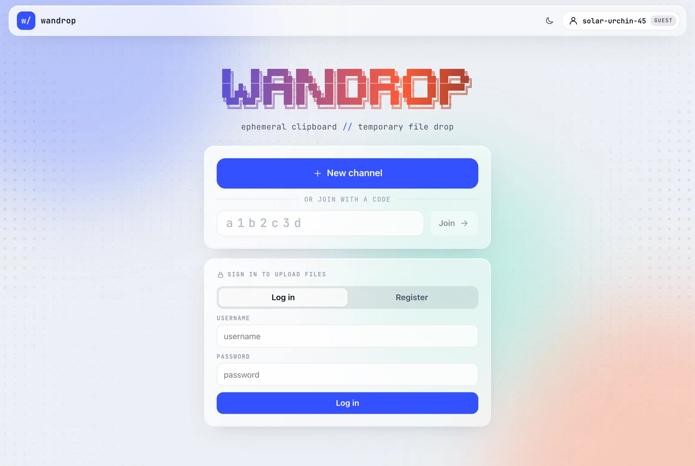

<div align="center">

<pre>
██╗    ██╗ █████╗ ███╗   ██╗██████╗ ██████╗  ██████╗ ██████╗
██║    ██║██╔══██╗████╗  ██║██╔══██╗██╔══██╗██╔═══██╗██╔══██╗
██║ █╗ ██║███████║██╔██╗ ██║██║  ██║██████╔╝██║   ██║██████╔╝
██║███╗██║██╔══██║██║╚██╗██║██║  ██║██╔══██╗██║   ██║██╔═══╝
╚███╔███╔╝██║  ██║██║ ╚████║██████╔╝██║  ██║╚██████╔╝██║
 ╚══╝╚══╝ ╚═╝  ╚═╝╚═╝  ╚═══╝╚═════╝ ╚═╝  ╚═╝ ╚═════╝ ╚═╝
</pre>

**Ephemeral web clipboard and temporary file drop, organised as IM channels.**

Open a channel, share the 7-character code, paste text or drop files. Everything self-destructs.


English · [简体中文](README_ZH.md)

</div>

<p align="center">
  
  
</p>
<p align="center">
  
</p>

## Why WanDrop?

You need to move a command, a log snippet or a build artefact from one machine to another *right now*, and you do not want it to live forever in a chat history or a cloud drive. WanDrop gives you a throwaway room for exactly that:

- **No setup for guests.** Visitors get a random name (`vivid-hare-02`) and can read, paste and download immediately.
- **Everything expires.** Messages fade after 5 minutes, channels after 1 hour, files are locked after 2 downloads (all configurable).
- **Async by design.** Unlike WebRTC tools, the receiver does not have to be online when you send.
- **Controlled uploads.** Only invited, signed-in users can upload files, so a public instance is not an open file host.

## Features

| | |
|---|---|
| 💬 **Channels** | 7-character `[0-9a-z]` IDs (`/c/k2z0vm2`), real-time sync over WebSocket, presence avatars |
| 📝 **Rich text** | Per-message Plain / Markdown switch, GFM tables, KaTeX (`$…$`, `$$…$$`, `\(…\)`, `\[…\]`), code blocks with copy button |
| ✏️ **Editing** | Edit your own messages (`✎ edited at hh:mm:ss`), one-click copy, delete |
| 📦 **Files** | Drag & drop or paste to upload, SHA-256 shown, per-file download cap and lifetime; a used-up file stays listed so the uploader can extend it; copy a direct download link for curl / wget |
| ⏯️ **Resumable uploads** | Chunked uploads you can pause and resume; survive dropped connections, page reloads and server restarts |
| ⏳ **Lifetimes** | Channel owner sets message retention (or "until channel ends") and channel lifetime |
| 🔐 **Accounts** | Invite-only registration, self-service password change, admin UI and CLI for invite codes |
| 🎨 **UI** | Light / dark theme, animated ASCII background, works on phones |

### Downloading with curl / wget

The 🔗 button on a file card copies a direct download link. It needs no browser session, so you can fetch the file on another machine:

```bash
curl -fLOJ 'https://drop.example.com/dl/<file-id>/<secret>'
```

Each fetch counts against the file's download cap like a browser download, and the link stops working once the file is locked, expires or is deleted. Anyone holding the link can download, so share it like a password.

### Default rules

| Rule | Default |
|---|---|
| Message retention | 5 minutes (owner can change, or keep until the channel ends) |
| Channel lifetime | 1 hour (owner can change: up to 24 h for guests, 7 days for signed-in users) |
| Files | Upload requires an account; anyone in the channel can download. Locked after 2 downloads (the uploader can raise the limit); deleted when their lifetime or the channel ends |
| Max file size | 100 MB per file for members, no limit for admins |
| Storage per user | 1 GB of stored files per member (files count until they are deleted or expire), no limit for admins |

## How it compares

| | **WanDrop** | [PairDrop](https://github.com/schlagmichdoch/PairDrop) | [Chitchatter](https://github.com/jeremyckahn/chitchatter) | [enchat](https://github.com/sudodevdante/enchat) | [PsiTransfer](https://github.com/psi-4ward/psitransfer) | [Send](https://github.com/timvisee/send) | [PrivateBin](https://github.com/PrivateBin/PrivateBin) | [pcopy](https://github.com/binwiederhier/pcopy) | [ClipCascade](https://github.com/Sathvik-Rao/ClipCascade) | [Mattermost](https://github.com/mattermost/mattermost) / [Rocket.Chat](https://github.com/RocketChat/Rocket.Chat) |
|---|:-:|:-:|:-:|:-:|:-:|:-:|:-:|:-:|:-:|:-:|
| Shape | IM channels | P2P device drop | P2P chat rooms | Terminal chat | File buckets | File links | Pastebin | Clipboard + links | Clipboard sync | Team chat |
| Chat-style rooms | ✅ | ➖ | ✅ | ✅ | ❌ | ❌ | ➖ comments | ❌ | ❌ | ✅ |
| Receiver can be offline | ✅ | ❌ | ❌ | ❌ | ✅ | ✅ | ✅ | ✅ | ✅ | ✅ |
| Message history while room lives | ✅ | ❌ | ❌ | ❌ | – | – | ✅ | ✅ | ➖ | ✅ |
| Edit messages | ✅ | ❌ | ❌ | ❌ | – | – | ❌ | – | – | ✅ |
| Markdown + math | ✅ | ❌ | ➖ | ❌ | – | – | ➖ | ❌ | ❌ | ➖ |
| Auto-expiry of everything | ✅ | ✅ | ✅ | ✅ | ✅ | ✅ | ✅ | ✅ | ➖ | ❌ |
| Per-file download limit | ✅ | – | – | – | ✅ one-time | ✅ | ➖ burn | ❌ | ❌ | ❌ |
| Guests without sign-up | ✅ | ✅ | ✅ | ✅ | ✅ | ✅ | ✅ | ➖ | ❌ | ❌ |
| Uploads restricted to members | ✅ | ❌ | ❌ | ❌ | ➖ password | ➖ | ❌ | ➖ password | ✅ | ✅ |
| Invite-only accounts | ✅ | ❌ | ❌ | ❌ | ❌ | ❌ | ❌ | ❌ | ➖ | ✅ |
| End-to-end encryption | ❌ | ✅ | ✅ | ✅ | ❌ | ✅ | ✅ | ❌ | ✅ | ❌ |
| Footprint | 1 small container | 1 container | static site | Python CLI + relay | 1 container | 1 container (+ Redis) | PHP app | Go binary | 1 container | DB + several services |

✅ yes · ➖ partial / optional · ❌ no · – not applicable. Based on each project's public docs at the time of writing; corrections are welcome.

**Where WanDrop fits:** it sits between a pastebin and a team chat. You get the chat-room flow (several people, several messages and files, editing, Markdown) of Mattermost with the "nothing survives" guarantees of PsiTransfer or PrivateBin, and none of the "both devices must be online" constraint of WebRTC tools.

**What it does *not* do:** content is encrypted in transit (behind HTTPS) but not end-to-end; the server can read messages and files until they expire. If that matters, use PrivateBin, Send or a P2P tool.

## Quick start

```bash
cp .env.example .env
docker compose up -d --build
docker compose logs wandrop | grep "Admin account"   # one-time generated admin password
# open http://127.0.0.1:8080
```

The port is bound to `127.0.0.1` by default. For public access, put WanDrop behind an HTTPS reverse proxy and set:

```env
COOKIE_SECURE=true
TRUST_PROXY=true
ALLOWED_ORIGINS=https://drop.example.com
```

The proxy must forward WebSocket upgrades on `/ws` and allow request bodies a little larger than `UPLOAD_CHUNK_MB` (16 MB by default; nginx: `client_max_body_size 20m;`). Because uploads are chunked, proxies with a body cap such as Cloudflare's 100 MB do not limit the file size.

## Admin account and invites

Registration requires an invite code. The first admin is created on first boot:

- **Generated password (recommended).** Leave `ADMIN_PASSWORD` empty. A random password is printed once in the logs; log in and change it under the account menu → *Change password*.
- **Docker secret.** Set `ADMIN_PASSWORD_FILE=/run/secrets/…` (see the commented `secrets:` block in `docker-compose.yml`).
- **Plain variable.** `ADMIN_PASSWORD=…` works, but placeholders such as `change-me-please` are rejected.

`ADMIN_*` are only read while no admin exists. After that they are ignored (and a warning is logged if the password is still set), so remove it from `.env`.

Manage invites in the web UI (account chip → *Manage invite codes*) or with the CLI:

```bash
docker compose exec wandrop /nodejs/bin/node server/admin.js invite 5 24    # 5 uses, valid 24 h
docker compose exec wandrop /nodejs/bin/node server/admin.js invites
docker compose exec wandrop /nodejs/bin/node server/admin.js users
docker compose exec wandrop /nodejs/bin/node server/admin.js passwd admin   # forgot it? new random password, signs out all sessions
```

## Security

- **File names never reach a path or a command.** Blobs are stored under random server-generated IDs. The original name is NFC-normalised, stripped of control characters, bidi overrides (RLO etc.), path separators and shell metacharacters, stored only in the database and always rendered as text. The codebase never calls `child_process`.
- **Downloads** are always `application/octet-stream` with `Content-Disposition: attachment` (RFC 5987), `nosniff` and `CSP: sandbox`, so uploaded HTML/SVG is never rendered as a page on this origin. A download first exchanges a POST for a 60-second single-use ticket, so link previews and prefetchers cannot burn download counts. The copied direct link instead carries a random per-file secret (the channel code is not enough to build it); `HEAD` does not count, and known link-preview bots are refused. The counter is incremented atomically in SQLite, so concurrent requests cannot exceed the limit.
- **Uploads** are chunked and resumable. The declared size is checked against the per-file limit, the uploader's quota, the channel quota and the global quota *before* any byte is accepted, and stays reserved until the upload finishes or is cancelled. Each chunk must start at the server's current offset and is metered while streamed to disk, so a client cannot write past the declared size. The SHA-256 is computed by the server over the finished file.
- **Web:** strict CSP (no inline scripts, connections only to the same origin), Markdown with raw HTML disabled and DOMPurify sanitisation, HttpOnly + SameSite cookies, same-origin checks for writes and WebSocket upgrades, rate limits on login, registration, password change, upload and send, scrypt password hashing. Changing a password signs out every other session.
- **Container:** distroless runtime (no shell, no package manager), non-root (uid 65532), read-only root filesystem, `cap_drop: ALL`, `no-new-privileges`, pids/memory/CPU limits. The only writable places are the `/data` volume (SQLite + files, mode 0600) and a `noexec` `/tmp` tmpfs.

## Configuration

All options live in [`.env.example`](.env.example). The common ones:

| Variable | Default | Meaning |
|---|---|---|
| `ADMIN_USERNAME` / `ADMIN_PASSWORD` / `ADMIN_PASSWORD_FILE` | `admin` / generated | First-boot admin |
| `MSG_TTL_DEFAULT` | `300` | Message retention for new channels (s) |
| `CHANNEL_TTL_DEFAULT` | `3600` | Lifetime of new channels (s) |
| `CHANNEL_TTL_MAX_ANON` / `CHANNEL_TTL_MAX_USER` | `86400` / `604800` | Max lifetime a guest / member can set (s) |
| `MAX_FILE_MB` | `100` | Max size per file (members) |
| `USER_QUOTA_MB` | `1024` | Storage per member (admins: unlimited) |
| `UPLOAD_CHUNK_MB` / `UPLOAD_STALE_HOURS` | `16` / `24` | Upload chunk size; how long an idle unfinished upload is kept |
| `CHANNEL_QUOTA_MB` / `GLOBAL_QUOTA_MB` | `1024` / `20480` | Storage quotas |
| `DEFAULT_MAX_DOWNLOADS` | `2` | Download cap for new files |
| `COOKIE_SECRET` / `COOKIE_SECRET_FILE` | generated | Cookie signing secret (≥ 32 chars); persisted in the volume if unset |

## Development

```bash
npm install
npm run build && DATA_DIR=./data npm start
# or with hot reload: start the backend on PORT=8080, then
npm run dev
```

```
server/   Fastify backend (auth / channels / messages / files / ws / sweeper)
web/      Vite frontend (vanilla JS + markdown-it + KaTeX + DOMPurify)
docs/     Screenshots
```
