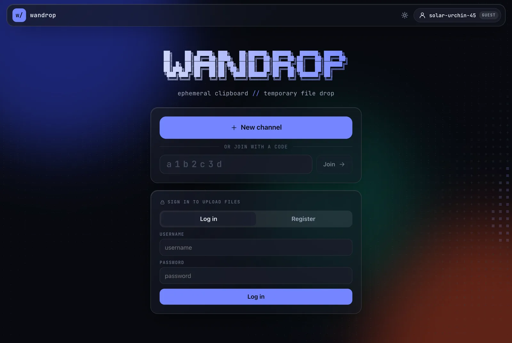
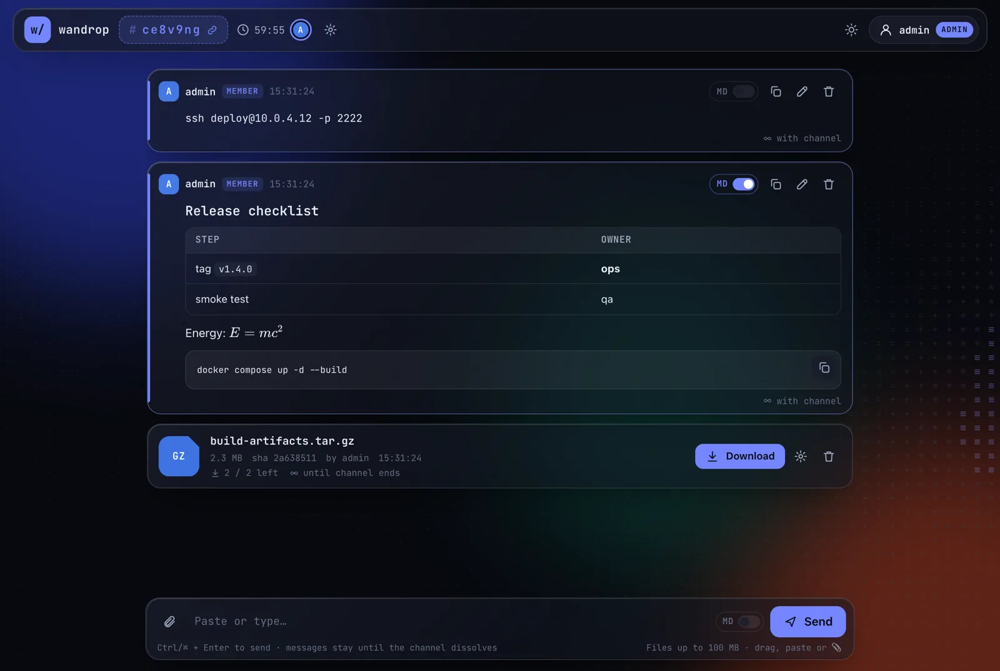

# WanDrop

[English](README.md) · 简体中文

<p align="center">
  
  
</p>

网页剪切板 + 临时文件转存中心，以 IM 频道的形式工作。每个频道有一个 7 位 `[0-9a-z]` 标识符（如 `/c/k2z0vm2`），访客自动获得随机用户名。所有内容都会自动过期销毁。

| 默认规则 | 值 |
|---|---|
| 消息留存 | 5 分钟（频道创建者可改，或设为"随频道"） |
| 频道寿命 | 1 小时（创建者可改：匿名最长 24h，登录用户最长 7 天） |
| 文件 | 仅登录用户可上传，任何人可下载；默认 2 次下载后锁定（上传者可提高次数），到期或随频道一起销毁 |
| 单文件上限 | 100 MB |

功能：Plain / Markdown 切换（气泡右上角 switch，支持 GFM 表格、KaTeX 公式 `$…$` `$$…$$` `\(…\)` `\[…\]`、代码块复制）、一键复制、编辑消息（显示 `✎ edited at hh:mm:ss`）、WebSocket 实时同步、拖拽/粘贴上传、明暗主题、ASCII 动画背景。

## 部署

```bash
cp .env.example .env
docker compose up -d --build
docker compose logs wandrop | grep "Admin account"   # 首次启动生成的管理员密码（只显示一次）
# http://127.0.0.1:8080
```

默认只监听 `127.0.0.1`；公网访问请放在 HTTPS 反向代理之后，并设置：

```env
COOKIE_SECURE=true
TRUST_PROXY=true
ALLOWED_ORIGINS=https://drop.example.com
```

反向代理需要转发 WebSocket（`/ws`），并允许 ≥100 MB 的请求体（nginx：`client_max_body_size 110m;`）。

## 账号与邀请码

注册必须使用邀请码。首个管理员在首次启动时创建：

- **自动生成密码（推荐）**：`ADMIN_PASSWORD` 留空，随机密码会在日志中打印一次；登录后可在账号菜单 → *Change password* 修改。
- **Docker secret**：设置 `ADMIN_PASSWORD_FILE=/run/secrets/…`（见 `docker-compose.yml` 中注释掉的 `secrets:`）。
- **明文变量**：`ADMIN_PASSWORD=…` 仍可用，但 `change-me-please` 等占位密码会被拒绝。

`ADMIN_*` 只在还没有管理员时读取，之后会被忽略（若密码仍在环境变量里会打印警告），请从 `.env` 中删除。

- 网页：以管理员登录后，点右上角账号 → *Manage invite codes*
- 命令行：

```bash
docker compose exec wandrop /nodejs/bin/node server/admin.js invite 5 24   # 5 次可用，24 小时有效
docker compose exec wandrop /nodejs/bin/node server/admin.js invites
docker compose exec wandrop /nodejs/bin/node server/admin.js users
docker compose exec wandrop /nodejs/bin/node server/admin.js passwd admin   # 忘记密码时：重置为随机密码并登出所有会话
```

## 与其他开源项目对比

详见英文版 [How it compares](README.md#how-it-compares)。简言之：WanDrop 介于 pastebin 和团队 IM 之间——有频道、多条消息、编辑、Markdown，同时所有内容自动销毁、下载次数可控；接收方无需同时在线（区别于 PairDrop / Chitchatter 等 WebRTC 方案）。不足：只有传输加密（HTTPS），没有端到端加密。

## 安全设计

- **文件名永不进入路径或命令**：磁盘上的文件名是服务端生成的随机 ID；原始文件名经过 NFC 规范化，并去掉控制字符、双向覆盖字符（RLO 等）、路径分隔符和 shell 元字符，之后只存进数据库，前端一律以纯文本渲染。整个代码库不调用 `child_process`。
- **下载**：固定 `application/octet-stream` + `Content-Disposition: attachment`（RFC 5987）+ `nosniff` + `CSP: sandbox`，用户上传的 HTML/SVG 永远不会在本站以页面形式渲染。下载需先 POST 换取 60 秒一次性票据，防止链接预览或预取消耗下载次数。下载计数在 SQLite 中原子递增，并发也不会超发。
- **上传**：流式写入并实时计量，超过上限立即中止并删除临时文件；同时限制频道配额、全局配额和每频道文件数。
- **Web**：严格 CSP（禁止内联脚本）、Markdown 禁用原始 HTML 并经 DOMPurify 清洗、HttpOnly + SameSite cookie、写操作和 WebSocket 都做同源校验、登录/注册/上传/发消息分别限速、scrypt 密码哈希。
- **容器**：distroless 运行镜像（无 shell、无包管理器），非 root（uid 65532），只读根文件系统，`cap_drop: ALL`，`no-new-privileges`，并限制 pids/内存/CPU。唯一可写位置是 `/data` 卷（SQLite + 文件，权限 0600）和一个 `noexec` 的 `/tmp` tmpfs。

## 配置

见 `.env.example`。常用项：`MAX_FILE_MB`、`CHANNEL_QUOTA_MB`、`GLOBAL_QUOTA_MB`、`DEFAULT_MAX_DOWNLOADS`、`MSG_TTL_DEFAULT`、`CHANNEL_TTL_DEFAULT`、`CHANNEL_TTL_MAX_ANON`、`CHANNEL_TTL_MAX_USER`。

## 本地开发

```bash
npm install
npm run build && DATA_DIR=./data npm start
# 或前端热更新：先启动后端 (PORT=8080)，再 npm run dev
```

## 结构

```
server/   Fastify 后端（auth / channels / messages / files / ws / sweeper）
web/      Vite 前端（原生 JS + markdown-it + KaTeX + DOMPurify）
```
